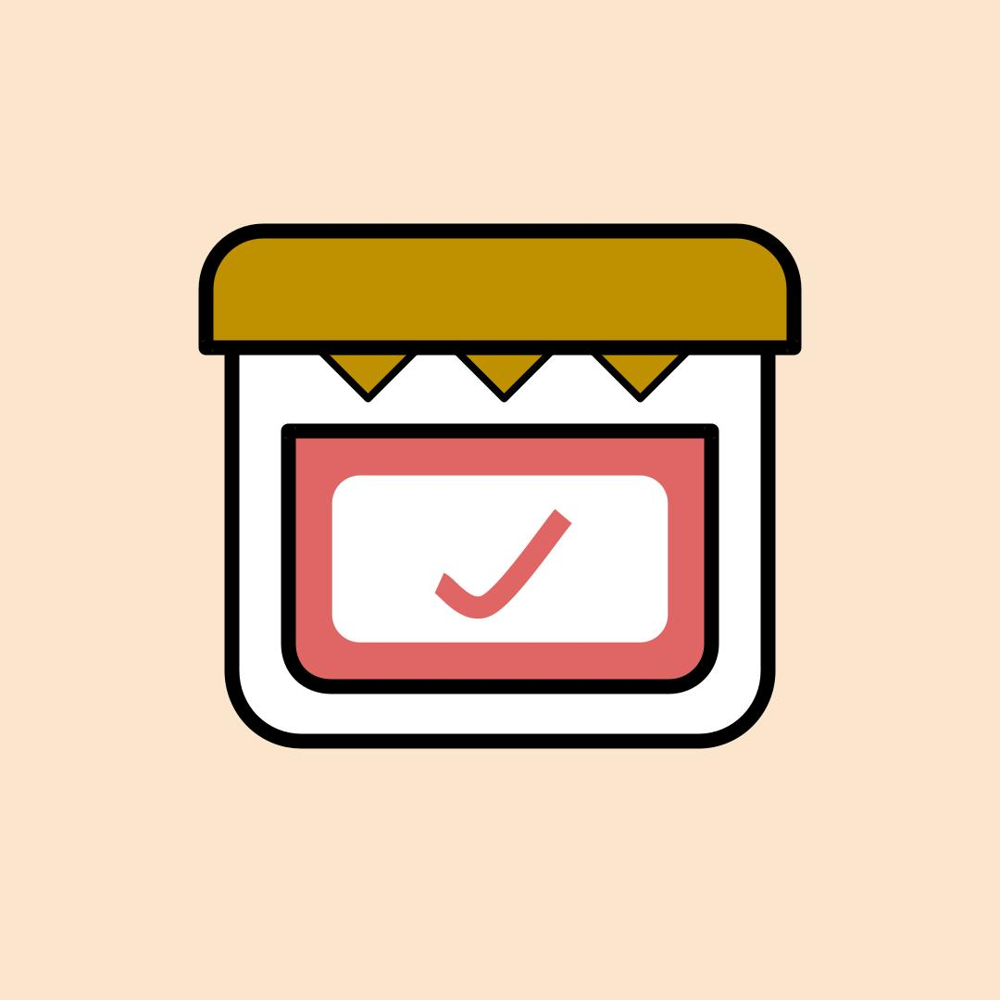

<p align="center">
  <a href="https://jampacked.co.nz"></a>
</p>

<h1 align="center">JamPacked</h1>

<p align="center">
  Goods inwards, stock and food safety programmes for New Zealand and Australian food businesses.<br>
  Built and owned by <a href="https://savepoint.co.nz"><b>Save Point Limited</b></a> (trading as JamPacked), New Zealand.
</p>

<p align="center">
  <a href="https://app.jampacked.co.nz">App</a> ·
  <a href="https://jampacked.co.nz">Website</a> ·
  <a href="docs/DOCUMENTATION.md">Docs</a> ·
  <a href="docs/TESTING.md">Testing</a> ·
  <a href="docs/issues/README.md">Issues</a> ·
  <a href="SECURITY.md">Security</a> ·
  <a href="LICENSE">Licence</a>
</p>

---

> [!IMPORTANT]
> JamPacked is a commercial product and Save Point's proprietary software. The code is public so customers and partners can see how it works. It is **not** open source, and you may not run, copy or resell it. See [LICENSE](LICENSE).

Mobile-first Flutter app (Android, iOS, web) with a Convex backend, in the spirit of Safe Food Pro.
**Goods inwards, stock and production are the core**: every delivery becomes stock you can rotate, use,
make into your own products, dispatch, hold and recall, and anything entered once is picked or scanned after that. Each business follows a **programme module** (MPI National Programme 1, 2 or 3,
or a custom programme you build) and the app prompts for the checks and records that programme needs.
One account can run several businesses; you pick the one you're working in each day.

## Project layout

```
JamPacked/
├── app/                    # Flutter app (Android, iOS, web)
│   ├── lib/                # main.dart, screens/, services/ (Convex client, auth), theme
│   ├── assets/help/        # guides.json: the in-app Help and the website's /help/ page
│   ├── test/               # Unit and widget tests (100% coverage enforced)
│   ├── tool/               # check_coverage.dart
│   ├── screenshots/        # Renders the website's screenshots from demo data
│   └── android/  ios/  web/
├── backend/                # Convex backend (TypeScript)
│   ├── convex/             # schema.ts, one file per feature, lib/ helpers, _generated/
│   └── tests/              # Vitest + convex-test
├── web/                    # jampacked.co.nz: landing, pricing, help, legal, owner dashboard (Next.js)
│   ├── src/                # app/ routes, lib/site.ts (prices, contact details)
│   ├── public/  scripts/  tests/
├── deploy/                 # loganserver deploy: deploy.sh, docker-compose.yml, nginx.conf
├── docs/
│   ├── DOCUMENTATION.md    # Full technical and user documentation
│   ├── TESTING.md          # How the tests are organised
│   └── issues/             # Open issues and to-dos before launch
├── LICENSE                 # Proprietary, all rights reserved
└── SECURITY.md
```

The full file-by-file layout is in [`docs/DOCUMENTATION.md` §3](docs/DOCUMENTATION.md#3-repository-layout).

## Run it locally

```bash
# 1. Backend: local Convex deployment (no account needed), serves http://127.0.0.1:3210
cd backend && npm install
CONVEX_AGENT_MODE=anonymous npx convex dev      # or `npx convex dev` to log in and use a cloud dev deployment

# 2. App (in another terminal)
cd app && flutter pub get
flutter run -d chrome                                                 # web
flutter run -d <android-device> --dart-define=CONVEX_URL=http://10.0.2.2:3210   # Android emulator
flutter run --dart-define=CONVEX_URL=https://<your-deployment>.convex.cloud     # cloud deployment

# 3. Website (optional)
cd web && npm install
NEXT_PUBLIC_CONVEX_URL=http://127.0.0.1:3210 npm run dev                       # http://localhost:3000
```

Create an account on the sign-in screen: your details, then your main business and the programme it
follows (NP1 / NP2 / NP3 / custom). You're its admin. Add more businesses from the business picker or
**More**, and invite staff under **More → Members** (they sign up with the invited email and tick
"I've been invited").

**Upgrading an existing install?** Run `migrations:toMultiBusiness` once after deploying; see
[`docs/DOCUMENTATION.md` §14](docs/DOCUMENTATION.md#14-deployment-loganserver). Production (recipes, made
products, production runs) needs no migration: its fields are optional and existing products count as supplies.

## Tests

Backend (Vitest + convex-test), app (flutter_test) and website (Vitest + Testing Library) unit tests, all
with 100% coverage enforced:

```bash
cd backend && npm test                  # or: npm run test:coverage
cd app && flutter test                  # or: flutter test --coverage && dart run tool/check_coverage.dart
cd web && npm test                      # or: npm run test:coverage
```

See [`docs/TESTING.md`](docs/TESTING.md) for how the tests are organised and how to add new ones.

Open issues and to-dos before launch (hosting, Clerk, store release, scaling) are tracked in
[`docs/issues/`](docs/issues/README.md).

## What's in it

| Area | What it does |
|---|---|
| **Businesses** | One account, many businesses, a role in each (admin / manager / staff). Pick today's business after signing in. Invite staff by email. Archive, never delete. |
| **Goods inwards** | Supplier, invoice, vehicle check, then per item: barcode scan, batch/lot, use-by/best-before, probe temp, packaging/label checks, allergens, accept/reject, put-away location. Plus your programme's receiving checks. Live pass/fail against your temperature limits. |
| **Stock** | Accepted goods become stock lots: on hand by location (first-expiring first), use / sell / dispatch (to whom) / waste / adjust / move, HOLD and release, par levels and low-stock alerts, stocktakes with automatic correction and variance flags. Every change is an append-only movement. |
| **Programmes** | NP1, NP2 and NP3 modules built from MPI's Dec 2025 guidance, narrowed by what your business does (e.g. NP2 ECE, NP1 honey): receiving checks, the records you must keep (pest checks, thermometer checks, training, mock recall, sickness, transport, cooking, cooling, pH, water activity...) with limits that raise corrective actions, a monthly self-check and a **Due** list. Or build a **custom programme** (blank or copied from an NP) and reuse it across your businesses. |
| **Enter it once** | Anything typed once is picked or scanned after that: products and supplies (search or barcode, with unit, storage and allergens) at goods inwards, in recipes and in production; suppliers; customers you've dispatched to. Unknown barcodes fill in from Open Food Facts (name, allergens, NOVA/ultra-processed group). Picking a supplier suggests what they usually deliver. |
| **Production** | Products you make, alongside the supplies you buy. Save a recipe once (ingredients, how much a batch makes, shelf life); making a batch picks the ingredient stock first-expiring first, takes it out, and puts the batch into stock with its own batch code, use-by and allergens. Or make a one-off from whatever stock you pick. Batches trace back to supplier batches and forward to customers. |
| **Audits** | 4 built-in templates (goods receipt, daily FCP check, monthly review, hygiene) plus your programme's checklists. Starting one pre-answers questions from goods inwards, stock, temperatures, programme records and corrective actions, and shows the evidence. Sign-off locks the audit; "No" answers raise corrective actions. |
| **Corrective actions** | Raised automatically for rejected goods, out-of-range temps accepted, expired goods, unapproved suppliers, dirty vehicles, failed receiving checks, failed temp checks, records outside limits, recalls, stocktake variances and audit findings. Close out with a resolution. |
| **Temperature checks** | Chillers, freezers, hot holding, cooking (≥75°C), cooling. Out-of-range readings require a corrective action. |
| **Trace & recall** | Search batch code / product / barcode → which deliveries, when, from whom, what was made from it, how much is left and who it was dispatched to; batches made here show what went into them. One tap puts all of it on hold and raises a recall corrective action. |
| **Expiring stock** | Stock on hand approaching or past use-by / best-before. |
| **Insights** | More › Insights: what the business did over 7, 30 or 90 days, and how long everyday tasks take (receiving goods, making a batch, temperature checks, records), for the business and for you. Timed in the app from opening a form to saving it; no staff league tables. |
| **Help & support** | The ? on Home (or More › Help & support): searchable step-by-step guides, the same ones as the website's `/help/` page (one file, `app/assets/help/guides.json`), and the support email. A support chatbot that hands over to a person is planned ([`docs/issues/support-chatbot.md`](docs/issues/support-chatbot.md)). |
| **Records kept 7 years** | Every write (and sign-in, sign-out, failed sign-in) is logged with who, when, what and a field-level diff. Nothing is deleted: records are **voided with a reason**, businesses archived, stock changes append-only; a test enforces it. Admins can export everything as JSON. |

### Compliance basis
Programme modules follow MPI's National Programme 1, 2 and 3 guidance (Dec 2025 v2). Defaults follow
NZ Food Act 2014 / MPI Food Control Plan and FSANZ Food Standards Code
(Std 3.2.2 cl.5 receiving, 3.2.2A record-keeping, 1.2.3 allergen declarations incl. PEAL):
chilled ≤5°C, hot ≥60°C, frozen received frozen hard (≤-15°C, configurable). Switch NZ/AU and adjust limits in
More → Business settings. The modules and templates are a starting point; check them against your
registration and your verifier/EHO's expectations.

## Pricing
One licence per business, priced by the programme it follows (NZD incl. GST), with a 30-day money-back guarantee:

| Plan | Monthly | Yearly |
|---|---|---|
| NP1 (one user, no staff; with staff it's the NP2 price) | free | free |
| NP2 | $50 | $500 |
| NP3 | $100 | $1000 |
| Custom programme | $120 | $1200 |

Prices and Stripe links live in `web/src/lib/site.ts`. Billing isn't built yet, so the app doesn't enforce
plans: see [`docs/issues/billing-stripe.md`](docs/issues/billing-stripe.md).

## Auth: development now, Clerk later
See `docs/DOCUMENTATION.md` for full documentation.

Accounts are local: passwords are hashed with PBKDF2-SHA256 (100k iterations, per-user salt) in Convex actions
(`backend/convex/lib/password.ts`), and sessions are random 256-bit tokens with a 7-day expiry. Every function takes
`sessionToken`; business functions also take `businessId` and check membership via `requireMember`
(`backend/convex/lib/session.ts`).

To move to Clerk:
1. Add `backend/convex/auth.config.ts` with your Clerk issuer domain and `applicationID: "convex"`.
2. Change `getUser` in `lib/session.ts` to use `ctx.auth.getUserIdentity()` and look users up by Clerk subject.
3. In Flutter, swap the login/register calls in `app/lib/services/auth_service.dart` for `clerk_flutter` sign-in
   and send the Clerk JWT. Screens only use `AuthService.user`/`token`, so they don't change.

## Notes on the Convex client
`app/lib/services/convex_client.dart` calls Convex's HTTP API, so it works on web, Android and iOS with no
native build steps. Screens refetch after any mutation and support pull-to-refresh. For live push updates
across devices you can swap in the `convex_flutter` package (WebSocket subscriptions), which needs a Rust
toolchain for mobile builds.

## Secrets

No secrets are committed to this repo. Local Convex settings live in `backend/.env.local`, and the website's
in `web/.env*`. All of them are git-ignored, along with keystores, signing keys and `google-services.json`.
The production Convex instance runs on Save Point's own server and is configured there, never in git.
See [SECURITY.md](SECURITY.md).

## Ownership

**JamPacked** is © 2026 Save Point Limited, a New Zealand company (company number 9392145), trading as JamPacked. All rights reserved.

- App: [app.jampacked.co.nz](https://app.jampacked.co.nz)
- Website: [jampacked.co.nz](https://jampacked.co.nz) · [savepoint.co.nz](https://savepoint.co.nz)
- General enquiries: [contact@savepoint.co.nz](mailto:contact@savepoint.co.nz)
- Support, privacy and security: [support@savepoint.co.nz](mailto:support@savepoint.co.nz)

"JamPacked", "Save Point" and their logos are the property of Save Point Limited. MPI, FSANZ, Open Food Facts, Convex, Clerk and Stripe are the names of their respective owners. JamPacked is not affiliated with or endorsed by any of them.
